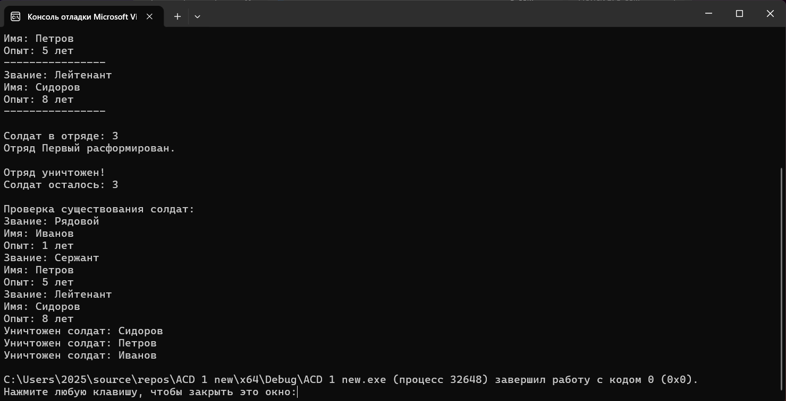

# Лабораторная работа № 1

## «Композиция и агрегация классов. Статические члены»

**Выполнил:** _Халмышев Мансур Асланбекович_
**Группа:** __ПИЖ-б-о-25-1__
**Вариант:** 10  
**Уровень:** Средний  
**Язык программирования:** C++
**Ccылка на репозиторий** https://github.com/mansurkhalmyshev-tech/Lab1-ACD

---

## 1. Цель работы

Изучить отношения между классами в объектно-ориентированном программировании, освоить реализацию агрегации в C++, научиться использовать статические поля и методы для подсчёта объектов, а также на практике проверить, что объекты класса-части могут продолжать существовать после уничтожения объекта класса-целого.

## 2. Теоретическая часть

### 2.1. Отношения между классами

В объектно-ориентированном программировании классы могут взаимодействовать друг с другом. Основными отношениями являются ассоциация, агрегация и композиция.

- **Ассоциация** — слабая связь, при которой один объект использует другой или знает о его существовании.
- **Агрегация** — отношение «часть–целое», при котором часть может существовать независимо от целого. Уничтожение целого не приводит к уничтожению частей.
- **Композиция** — более сильное отношение «часть–целое». Части принадлежат целому и обычно не могут существовать без него. При уничтожении целого уничтожаются и его части.

### 2.2. Агрегация в C++

Агрегацию можно реализовать с помощью указателей или ссылок на объекты, созданные независимо от объекта-контейнера.

В данной работе класс `Squad` хранит указатели на объекты `Soldier`. При этом `Squad` не создаёт солдат и не удаляет их. Он только хранит ссылки на уже существующие объекты и может обращаться к ним.

Таким образом, время жизни солдат не зависит от времени жизни отряда.

### 2.3. Статические члены класса

Статическое поле принадлежит всему классу, а не отдельному объекту. Для всех экземпляров класса существует одна общая копия такого поля.

Статическое поле удобно использовать для подсчёта количества созданных объектов. В данной работе в классе `Soldier` используется статическое поле `soldierCount`.

- При создании солдата счётчик увеличивается на единицу.
- При уничтожении солдата счётчик уменьшается на единицу.
- Статический метод `getSoldierCount()` возвращает текущее значение счётчика.

Статическое поле определяется вне класса.

## 3. Постановка задачи

**Общее задание для среднего уровня:** реализовать два класса, связанных отношением агрегации (часть может существовать без целого). Добавить статическое поле для подсчёта количества объектов класса «Часть». Продемонстрировать, что при уничтожении целого части продолжают существовать.

**Вариант 10:**

- Класс-целое — `Squad` (отряд).
- Класс-часть — `Soldier` (солдат).
- Поля класса `Soldier`: звание, имя, опыт.

Необходимо реализовать программу, в которой солдаты создаются независимо от отряда, добавляются в отряд, выводятся на экран, а после уничтожения отряда продолжают существовать. Также необходимо показать работу статического счётчика объектов класса `Soldier`.

## 4. Листинг программы

```cpp

#include <iostream>       // Подключаем библиотеку для ввода и вывода
#include <string>          // Подключаем библиотеку для работы со строками
#include <vector>          // Подключаем библиотеку для создания списков

using namespace std;       // Чтобы не писать std:: перед командами

// Создаём класс Soldier (Солдат)
class Soldier {
private:                   // Закрытая часть класса
    string rank;           // Звание солдата
    string name;           // Имя солдата
    int experience;        // Опыт службы в годах

    static int soldierCount; // Общий счётчик всех солдат

public:                    // Открытая часть класса

    // Конструктор класса Soldier
    Soldier(string r, string n, int exp) {
        rank = r;          // Записываем звание
        name = n;          // Записываем имя
        experience = exp;  // Записываем опыт

        soldierCount++;    // Увеличиваем количество солдат

        cout << "Создан солдат: " << name << endl; // Выводим сообщение
    }

    // Деструктор класса Soldier
    ~Soldier() {
        soldierCount--;    // Уменьшаем количество солдат

        cout << "Уничтожен солдат: " << name << endl; // Сообщаем об удалении
    }

    // Метод для получения имени солдата
    string getName() {
        return name;       // Возвращаем имя
    }

    // Метод для вывода информации о солдате
    void print() {
        cout << "Звание: " << rank << endl;          // Выводим звание
        cout << "Имя: " << name << endl;             // Выводим имя
        cout << "Опыт: " << experience << " лет" << endl; // Выводим опыт
    }

    // Статический метод для получения количества солдат
    static int getSoldierCount() {
        return soldierCount; // Возвращаем значение счётчика
    }
};

// Объявляем начальное значение статического счётчика
int Soldier::soldierCount = 0;


// Создаём класс Squad (Отряд)
class Squad {
private:                       // Закрытая часть класса
    string squadName;          // Название отряда

    vector<Soldier*> soldiers; // Список указателей на солдат (агрегация)

public:                        // Открытая часть класса

    // Конструктор класса Squad
    Squad(string name) {
        squadName = name;      // Записываем название отряда
        cout << "Создан отряд: " << squadName << endl; // Выводим сообщение
    }

    // Деструктор класса Squad
    ~Squad() {
        cout << "Отряд " << squadName << " расформирован." << endl;
        // Солдаты не удаляются, потому что существуют независимо от отряда
    }

    // Метод добавления солдата в отряд
    void addSoldier(Soldier* soldier) {

        if (soldier == nullptr) { // Проверяем, существует ли указатель
            cout << "Ошибка: солдат не существует!" << endl; // Выводим ошибку
            return;                  // Завершаем метод
        }

        soldiers.push_back(soldier); // Добавляем указатель в список

        cout << soldier->getName()   // Получаем имя солдата
            << " добавлен в отряд." << endl; // Выводим сообщение
    }

    // Метод вывода списка солдат
    void print() {

        cout << "\nОтряд: " << squadName << endl; // Выводим название отряда

        // Перебираем всех солдат в списке
        for (int i = 0; i < soldiers.size(); i++) {

            if (soldiers[i] != nullptr) { // Проверяем указатель

                soldiers[i]->print();     // Выводим информацию о солдате

                cout << "----------------" << endl; // Разделитель
            }
        }
    }
};


// Главная функция программы
int main() {

    setlocale(LC_ALL, "Russian"); // Включаем русский язык в консоли

    cout << "Количество солдат: "
        << Soldier::getSoldierCount() << endl; // В начале солдат 0

    // Создаём трёх солдат независимо от отряда
    Soldier s1("Рядовой", "Иванов", 1);   // Первый солдат
    Soldier s2("Сержант", "Петров", 5);  // Второй солдат
    Soldier s3("Лейтенант", "Сидоров", 8); // Третий солдат

    cout << "\nВсего солдат: "
        << Soldier::getSoldierCount() << endl; // Выводим количество

    { // Начало отдельного блока

        Squad squad("Первый"); // Создаём отряд

        squad.addSoldier(&s1); // Добавляем первого солдата
        squad.addSoldier(&s2); // Добавляем второго солдата
        squad.addSoldier(&s3); // Добавляем третьего солдата

        squad.print();         // Выводим информацию обо всех солдатах

        cout << "\nСолдат в отряде: "
            << Soldier::getSoldierCount() << endl; // Показываем счётчик

    } // Здесь отряд уничтожается, но солдаты остаются

    cout << "\nОтряд уничтожен!" << endl; // Выводим сообщение

    cout << "Солдат осталось: "
        << Soldier::getSoldierCount() << endl; // Всё ещё 3 солдата

    // Проверяем, что солдаты продолжают существовать
    cout << "\nПроверка существования солдат:" << endl;

    s1.print(); // Выводим первого солдата
    s2.print(); // Выводим второго солдата
    s3.print(); // Выводим третьего солдата

    return 0; // Завершаем программу
}

```

## 5. Результаты работы программы

При запуске программы сначала создаются три объекта `Soldier`. Затем они добавляются в объект `Squad`. После выхода из блока объект `Squad` уничтожается, но солдаты продолжают существовать, поскольку их время жизни не зависит от времени жизни отряда.

Пример ожидаемого вывода:


```
```

**Анализ результата:** после уничтожения отряда значение счётчика остаётся равным 3. Это подтверждает, что объекты `Soldier` не уничтожаются вместе с объектом `Squad`. Солдаты уничтожаются позднее — при завершении функции `main`, когда заканчивается время жизни локальных объектов `soldier1`, `soldier2` и `soldier3`.

*В отчёт следует добавить собственный скриншот окна консоли после запуска программы.*

## 6. Ответы на контрольные вопросы

### 1. Что такое композиция? Приведите пример.

Композиция — это сильное отношение между классами по принципу «часть–целое». При композиции объект-целое управляет временем жизни своих частей. Если целый объект уничтожается, его части также уничтожаются. Например, дом и комнаты: в модели композиции комнаты являются составными частями дома и уничтожаются вместе с ним.

### 2. Что такое агрегация? Чем она отличается от композиции?

Агрегация — это отношение «часть–целое», при котором объект-часть может существовать независимо от объекта-целого. Главное отличие от композиции заключается во времени жизни объектов. При агрегации уничтожение целого не уничтожает части, а при композиции части обычно уничтожаются вместе с целым.

### 3. Как реализовать композицию в C++? Приведите пример кода.

Композицию можно реализовать через поле-объект внутри другого класса или с помощью умного указателя `unique_ptr`. Например:

```cpp
class Room {
public:
    Room() {}
};

class House {
private:
    Room room; // Комната является частью дома
};
```

Объект `room` создаётся и уничтожается автоматически вместе с объектом `House`.

### 4. Как реализовать агрегацию в C++? Приведите пример кода.

Агрегацию можно реализовать с помощью указателя или ссылки на объект, который был создан независимо:

```cpp
class Soldier {
public:
    void print() const {
        cout << "Солдат" << endl;
    }
};

class Squad {
private:
    vector<Soldier*> soldiers;

public:
    void addSoldier(Soldier* soldier) {
        if (soldier != nullptr) {
            soldiers.push_back(soldier);
        }
    }
};
```

Класс `Squad` хранит указатели на солдат, но не удаляет объекты `Soldier`.

### 5. В чём разница между временем жизни частей при композиции и агрегации?

При композиции время жизни части связано со временем жизни целого: часть создаётся и уничтожается вместе с ним. При агрегации часть имеет самостоятельное время жизни. Она может быть создана до целого и продолжать существовать после его уничтожения.

### 6. Что такое статическое поле класса? Чем оно отличается от обычного поля?

Статическое поле принадлежит классу в целом и является общим для всех его объектов. Обычное поле принадлежит конкретному экземпляру класса, поэтому каждый объект имеет собственное значение такого поля. В работе `soldierCount` является статическим полем и хранит общее количество существующих объектов `Soldier`.

### 7. Как объявить и определить статическое поле? Где оно хранится?

Внутри класса статическое поле объявляется с ключевым словом `static`:

```cpp
class Soldier {
    static int soldierCount;
};
```

Затем оно определяется вне класса:

```cpp
int Soldier::soldierCount = 0;
```

Статическое поле существует в единственном экземпляре и хранится в статической области памяти программы, а не отдельно внутри каждого объекта.

### 8. Что такое статический метод? Можно ли из него обратиться к нестатическим полям?

Статический метод — это метод, который принадлежит классу и может вызываться без создания его объекта. Напрямую обращаться к нестатическим полям из статического метода нельзя, потому что у такого метода нет указателя `this` и он не знает, с каким именно объектом нужно работать. Статический метод может обращаться к статическим полям и методам.

### 9. Для чего используются статические счётчики объектов?

Статические счётчики используются для хранения общего количества объектов определённого класса. При создании объекта счётчик увеличивается, а при уничтожении уменьшается. Это позволяет контролировать количество существующих экземпляров класса.

### 10. Что такое паттерн «Одиночка» (Singleton)? Для чего он нужен?

Singleton — это порождающий паттерн проектирования, который гарантирует наличие только одного экземпляра определённого класса и предоставляет общий способ доступа к нему. Он может использоваться, например, для единого объекта настроек или менеджера ресурсов. В данной лабораторной работе паттерн Singleton не требуется, так как он относится к продвинутому уровню.

### 11. Как запретить создание копий объекта (конструктор копирования)?

Для запрета копирования можно объявить конструктор копирования и оператор присваивания удалёнными с помощью `= delete`:

```cpp
class Example {
public:
    Example(const Example&) = delete;
    Example& operator=(const Example&) = delete;
};
```

После этого компилятор не позволит копировать объекты данного класса.

### 12. В каком порядке вызываются конструкторы и деструкторы при композиции?

Сначала вызывается конструктор целого объекта, а затем конструкторы его частей в порядке объявления полей в классе. При уничтожении порядок обратный: сначала выполняется тело деструктора целого, затем уничтожаются его поля-объекты в обратном порядке их объявления.

### 13. Можно ли изменить статическое поле из обычного метода?

Да. Обычный метод может обращаться к статическому полю и изменять его. Например, конструктор `Soldier` увеличивает `soldierCount`, а деструктор уменьшает его.

### 14. Почему статические поля нужно определять вне класса?

В классическом варианте C++ объявление статического поля внутри класса сообщает компилятору о его существовании и типе. Определение вне класса выделяет для него память и задаёт начальное значение. В современных версиях C++ для некоторых случаев можно использовать `inline static`, но в данной работе применяется обычное определение вне класса.

### 15. В каких случаях стоит использовать композицию, а в каких — агрегацию?

Композицию следует использовать, когда часть полностью принадлежит целому и не должна существовать отдельно от него. Например, комнаты в упрощённой модели дома. Агрегацию следует использовать, когда объекты могут существовать самостоятельно и временно объединяться в группу. Например, солдаты могут существовать независимо от отряда и после его расформирования.

## 7. Вывод

В ходе лабораторной работы была изучена агрегация классов и её отличие от композиции. На примере классов `Squad` и `Soldier` была реализована связь, при которой отряд хранит указатели на независимо созданные объекты солдат, но не управляет их временем жизни.

Также было реализовано статическое поле `soldierCount` и статический метод `getSoldierCount()`, позволяющие отслеживать количество существующих объектов класса `Soldier`. В результате выполнения программы было подтверждено, что после уничтожения отряда все три солдата продолжают существовать и доступны для использования. Получены практические навыки создания классов, работы с указателями, векторами, конструкторами, деструкторами и статическими членами класса.

## 8. Ссылка на Git-репозиторий

**Ссылка:** ____________________________________

*После размещения исходного файла программы в собственном Git-репозитории вставьте сюда ссылку на него.*
